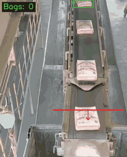
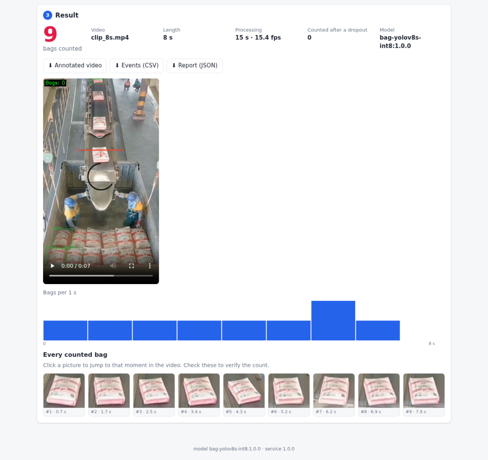

# Bag Counter

## Overview

Counts bags on a conveyor belt from a recorded video or a live RTSP camera, on CPU only. A YOLOv8s detector
(INT8, OpenVINO) finds the bags, ByteTrack follows them, and a bag is counted once when it crosses a line drawn on
the picture in the chosen direction. Ships as a Docker stack: web UI and REST API, an inference worker, and
Prometheus/Grafana monitoring. Every count is stored with its time, confidence and a snapshot of the bag.
Model weights: [eredirros/bag-counter-yolov8s-int8](https://huggingface.co/eredirros/bag-counter-yolov8s-int8).

## Installation

```bash
git lfs install
git clone <repo-url> && cd bag_counter
python3 scripts/fetch_model.py              # model weights from Hugging Face, SHA-256 verified
cp deploy/env.example deploy/.env      # set GRAFANA_ADMIN_PASSWORD and ports
docker compose -f deploy/docker-compose.yml --env-file deploy/.env up -d --build
docker compose -f deploy/docker-compose.yml exec worker python -m bagcounter.cli preflight
```

For development without Docker: `bash scripts/setup_env.sh && source venv/bin/activate`.

## Usage

Web UI at `http://<host>:8080`: upload a video, click two points across the belt, make sure the arrow points the
way the bags move, start counting. Results: count, annotated video, CSV/JSON report, a picture of every counted
bag. Live cameras: add an RTSP URL and draw the line on the live picture. Grafana at `:3000`, API docs at `/docs`.

Command line:

```bash
bagcounter count video.mp4 --line 0.3,0.35,0.7,0.35 --direction positive --out out/
python scripts/eval_count.py --gt ground_truth.json --report out/report.json
```

Line points are fractions of the frame (A → B); `positive` counts movement towards the side the arrow points to.

## Performance

8 CPU cores, 640×640 input. mAP on a fixed 1000-image validation subset.

| model | runtime | mAP50 | latency p50 |
|---|---|---|---|
| YOLOv8x | PyTorch FP32 | 0.963 | 223 ms |
| YOLOv8x | OpenVINO INT8 | 0.947 | 33 ms |
| **YOLOv8s** (shipped) | **OpenVINO INT8** | **0.944** | **7.7 ms** |
| YOLOv8n | OpenVINO INT8 | 0.913 | 4.9 ms |

| counting | result |
|---|---|
| overhead clip, 9 hand-timed crossings | 9 / 9, precision 1.00, recall 1.00 |
| factory line, 3.9 min, 98 bags counted by hand | 104 (+6.1 %) |
| live camera, 720×1280 @ 30 FPS in | 15 FPS processed, latency p95 ~110 ms |
| C++ detector vs Python (YOLOv8n) | 172 FPS async / 75 FPS |
| camera bitrate floor (720p) | ≥ 0.5 Mbit/s keeps the count; 120 kbit/s loses half |

Details: [experiments/edge/RESULTS.md](experiments/edge/RESULTS.md),
[experiments/results/video_experiments.md](experiments/results/video_experiments.md).

## Demo




